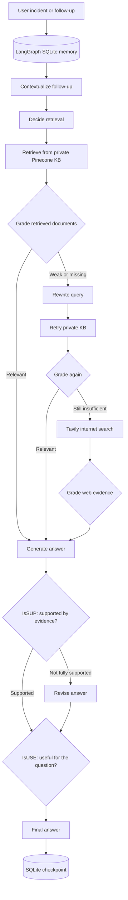
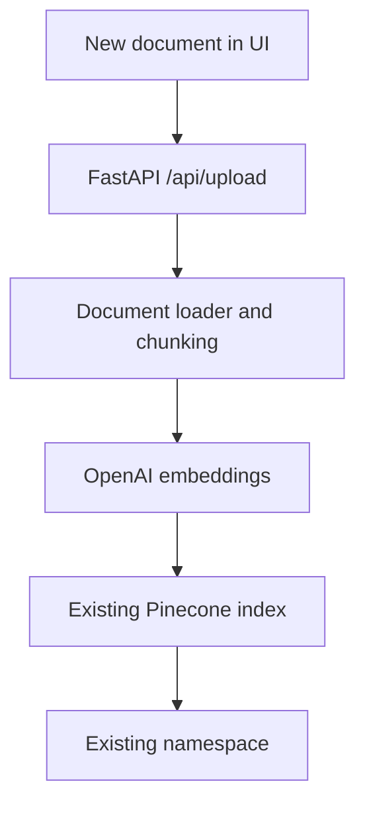

# runbook-copilot

**Enterprise Incident Response Self-RAG Copilot for Cloud Operations**

runbook-copilot is a production-style **Self-RAG** assistant for cloud operations and incident response. It searches your private operational knowledge (runbooks, SOPs, postmortems) in Pinecone first, grades the evidence it retrieves, corrects weak retrieval or weak answers, and falls back to **internet search only when the private knowledge base cannot answer the question**.

Conversation state is persisted with a **LangGraph SQLite checkpointer**, so follow-up questions in the same incident session reuse earlier context through a stable `thread_id`.

---

## Table of Contents

1. [Key Features](#key-features)
2. [Architecture](#architecture)
3. [Self-RAG Workflow Stages](#self-rag-workflow-stages)
4. [Tech Stack](#tech-stack)
5. [Project Structure](#project-structure)
6. [Prerequisites](#prerequisites)
7. [Getting Started](#getting-started)
8. [Building the Knowledge Base](#building-the-knowledge-base)
9. [Running the Application](#running-the-application)
10. [Using the Application](#using-the-application)
11. [Persistent Memory](#persistent-memory)
12. [Demo Walkthrough](#demo-walkthrough)
13. [Running with Docker](#running-with-docker)
14. [Configuration Consistency Rule](#configuration-consistency-rule)
15. [Troubleshooting](#troubleshooting)
16. [Moving to Production](#moving-to-production)
17. [Security Notes](#security-notes)
18. [License](#license)

---

## Key Features

- **Private-first retrieval:** every question is answered from your internal runbooks before anything external is consulted.
- **Self-grading:** retrieved chunks are graded for relevance, and generated answers are checked for evidence support (**IsSUP**) and usefulness (**IsUSE**).
- **Corrective loop:** weak or missing evidence triggers a query rewrite and a second pass over the private knowledge base.
- **Controlled web fallback:** Tavily search is used only when internal evidence remains insufficient, and web results go through the same grading.
- **Persistent incident memory:** follow-ups like "what next?" are rewritten into standalone questions using the stored thread history.
- **Live knowledge expansion:** upload a new runbook from the UI and query it immediately, with no re-ingestion step.
- **Single source of vector config:** ingestion and runtime retrieval share one module, so embeddings, index, and namespace never drift apart.
- **Idempotent ingestion:** stable chunk IDs mean rerunning ingestion updates existing vectors instead of duplicating them.
- **Container ready:** ships with a `Dockerfile` and `docker-compose.yml`.

---

## Architecture



The graph always tries the private knowledge base first. Internet search is a fallback path, not a parallel source.

---

## Self-RAG Workflow Stages

| Stage | Purpose |
|---|---|
| **Contextualize** | Uses the persisted thread history to turn a follow-up into a standalone operational question. |
| **Decide retrieval** | Determines how the question should be handled before retrieval begins. |
| **Retrieve (private)** | Runs similarity search against the configured Pinecone index and namespace. |
| **Grade documents** | LLM grades each retrieved chunk for relevance to the question. |
| **Rewrite query** | Reformulates the query when private evidence is weak or missing. |
| **Retry private KB** | Searches Pinecone again with the rewritten query. |
| **Internet search** | Queries Tavily, only when private evidence is still insufficient. |
| **Grade web evidence** | Applies the same relevance grading to web results. |
| **Generate** | Produces an answer grounded in the graded evidence. |
| **IsSUP** | Checks whether the answer is supported by the evidence. |
| **Revise** | Rewrites the answer when parts of it are not supported. |
| **IsUSE** | Checks whether the answer actually addresses the user's question. |

All LLM-driven stages (routing, rewriting, generation, grading, IsSUP, IsUSE) use `gpt-5-mini`.

---

## Tech Stack

| Layer | Technology | Role |
|---|---|---|
| Orchestration | **LangGraph** | Self-RAG workflow, conditional routing, persistent thread state |
| LLM | **OpenAI `gpt-5-mini`** | Routing, query rewriting, generation, relevance grading, IsSUP, IsUSE |
| Embeddings | **OpenAI `text-embedding-3-large`** | 3072-dimension embeddings for private documents |
| Vector store | **Pinecone** | Private runbooks, SOPs, and postmortems |
| Web fallback | **Tavily** | Controlled internet search |
| Persistence | **SQLite** | LangGraph checkpoints and a simple audit database |
| Backend | **FastAPI** | API and application server |
| Frontend | **HTML / CSS / JavaScript** | Incident command center UI with document upload |
| Packaging | **Docker** | Deployment |

---

## Project Structure

```text
runbook-copilot/
├── app.py                     # FastAPI app: UI, chat, and upload endpoints
├── data_ingestion.py          # One command to build the Pinecone knowledge base
├── src/
│   ├── config.py              # Environment and settings
│   ├── db.py                  # SQLite audit database helpers
│   ├── ingestion.py           # Shared loading and chunking logic
│   ├── models.py              # LLM and embedding model setup
│   ├── self_rag.py            # LangGraph Self-RAG workflow
│   └── vectorstore.py         # Single source of embedding, index, and namespace config
├── documents/                 # Initial private knowledge documents
│   ├── checkout-api-runbook.md
│   ├── payments-high-cpu-runbook.md
│   └── deployment-rollback-sop.md
├── templates/
│   └── index.html             # Incident command center UI
├── static/
│   ├── styles.css
│   └── app.js
├── uploads/                   # Documents uploaded through the UI
├── data/                      # SQLite persistence files
├── requirements.txt
├── Dockerfile
├── docker-compose.yml
└── .env.example
```

---

## Prerequisites

- **Conda** (Miniconda or Anaconda)
- **Python 3.11** (installed into the conda environment below)
- **OpenAI API key** with access to `gpt-5-mini` and `text-embedding-3-large`
- **Pinecone API key**
- **Tavily API key** (needed for the internet search fallback)
- *Optional:* Docker and Docker Compose

---

## Getting Started

### 1. Clone the repository

```bash
git clone https://github.com/kaushik183/runbook-copilot.git
cd runbook-copilot
```      

### 2. Create and activate the conda environment

```bash
conda create -n env_runbook_project python=3.11 -y
conda activate env_runbook_project
```

> On Windows, run these in **Anaconda Prompt**, or run `conda init` once and restart your terminal.

### 3. Install dependencies

```bash
pip install -r requirements.txt
```

### 4. Configure environment variables

Copy the example file:

macOS / Linux:

```bash
cp .env.example .env
```

Windows:

```bash
copy .env.example .env
```

Then fill in your keys:

```env
OPENAI_API_KEY=...
PINECONE_API_KEY=...
TAVILY_API_KEY=...
```

Defaults for the remaining settings:

```env
OPENAI_MODEL=gpt-5-mini
EMBEDDING_MODEL=text-embedding-3-large
EMBEDDING_DIMENSION=3072
PINECONE_INDEX_NAME=cloudops-sentinel-openai-self-rag
PINECONE_NAMESPACE=incident-runbooks
```

| Variable | Required | Default | Description |
|---|---|---|---|
| `OPENAI_API_KEY` | Yes | | OpenAI API key |
| `PINECONE_API_KEY` | Yes | | Pinecone API key |
| `TAVILY_API_KEY` | Yes, for web fallback | | Tavily API key |
| `OPENAI_MODEL` | No | `gpt-5-mini` | Chat model for every LLM stage |
| `EMBEDDING_MODEL` | No | `text-embedding-3-large` | Embedding model for ingestion and retrieval |
| `EMBEDDING_DIMENSION` | No | `3072` | Must match the embedding model output and the Pinecone index |
| `PINECONE_INDEX_NAME` | No | `cloudops-sentinel-openai-self-rag` | Pinecone index name |
| `PINECONE_NAMESPACE` | No | `incident-runbooks` | Namespace inside the index |

> **Why a new index name?** An earlier version of this project used local embeddings with a different vector dimension. Pinecone cannot mix dimensions within one index, so the OpenAI version uses a fresh default index.

---

## Building the Knowledge Base

Place your initial **PDF, TXT, Markdown, or DOCX** files in `documents/`, then run:

```bash
python data_ingestion.py
```

This single script runs the full pipeline:

1. Reads configuration from `.env`
2. Creates or validates the Pinecone index
3. Loads every supported file from `./documents`
4. Splits documents into chunks
5. Embeds chunks with `text-embedding-3-large`
6. Upserts vectors into Pinecone
7. Leaves the configured namespace ready for queries

**Safe to rerun.** Chunks get stable IDs, so running the script again updates matching vectors instead of creating duplicates with new random IDs.

---

## Running the Application

Start the server with either command:

```bash
python app.py
```

```bash
uvicorn app:app --reload
```

Then open:

```text
http://127.0.0.1:8000
```

FastAPI's interactive API docs are available at `http://127.0.0.1:8000/docs`.

---

## Using the Application

### Asking incident questions

Describe the incident in the chat panel. Each answer indicates the route it took, either **Private Runbooks** or **Internet Search**, so you can see when the system had to leave your internal knowledge.

### Adding documents from the UI

The left-side **Runbook Vault** accepts PDF, TXT, Markdown, and DOCX files. Clicking **Add to knowledge base** sends the file through the same ingestion layer and embedding model used by `data_ingestion.py`:



The status message reports how many chunks were added. The new content is searchable immediately.

---

## Persistent Memory

Every browser incident session has a persistent `thread_id`. The LangGraph workflow is compiled with a SQLite checkpointer that stores state in:

```text
data/langgraph_memory.sqlite
```

**Example**

1. *"Our checkout API is returning 502 errors after deployment. What should I check first?"*
2. *"What should I check next if that doesn't work?"*

For the second message, the **contextualize** node reads the stored incident context and rewrites the follow-up into a standalone question (for example, about next steps for checkout API 502s after a deployment) before running it through Self-RAG.

**Resetting memory:** stop the app and delete `data/langgraph_memory.sqlite` to clear all stored conversations.

> SQLite is used for local development and demos. See [Moving to Production](#moving-to-production) for alternatives.

---

## Demo Walkthrough

Build the knowledge base before recording, then follow these four scenarios.

### Demo A: Existing private knowledge

> Our checkout API is returning 502 errors after deployment. What should the on-call engineer check first?

**Expected route:** Private Runbooks

### Demo B: Persistent memory

Immediately follow up in the same session:

> What should I check next if that does not work?

**Expected behavior:** the same `thread_id` carries the earlier incident context forward.

### Demo C: Live knowledge upload

Upload a new PDF, Markdown, or DOCX runbook from the Runbook Vault. Note the chunk count in the status message, then ask a question whose answer exists **only** in that new document.

**Expected route:** Private Runbooks, citing the newly uploaded content

### Demo D: Internet search fallback

Ask about a technical issue that none of your runbooks cover.

**Expected behavior:** Self-RAG searches the private KB, grades the evidence, rewrites the query, retries, and only then switches to **Internet Search** when internal evidence is still insufficient.

---

## Running with Docker

Make sure `.env` exists in the project root, then:

```bash
docker compose up --build
```

Open `http://127.0.0.1:8000`.

Without Compose:

```bash
docker build -t runbook-copilot .
docker run --env-file .env -p 8000:8000 runbook-copilot
```

**Notes**

- Pinecone is a managed cloud index, so you can run `python data_ingestion.py` from your conda environment on the host. The container connects to the same index.
- To keep memory and uploaded files across container rebuilds, mount `data/` and `uploads/` as volumes in `docker-compose.yml`.

---

## Configuration Consistency Rule

Both `app.py` and `data_ingestion.py` import `src/vectorstore.py`. That guarantees ingestion and runtime retrieval always share the same:

- Embedding model
- Embedding dimension
- Pinecone index
- Pinecone namespace

This prevents a common RAG failure where documents are embedded one way offline and queried another way at runtime, which silently ruins retrieval quality.

---

## Troubleshooting

| Symptom | Likely cause | Fix |
|---|---|---|
| Pinecone dimension mismatch error | Index was created with a different dimension (for example, by the earlier local embedding version) | Use a new `PINECONE_INDEX_NAME` or delete the old index |
| Every answer routes to Internet Search | Namespace is empty, or `PINECONE_NAMESPACE` differs from the one used at ingestion | Run `python data_ingestion.py` and confirm the namespace value |
| Uploaded document never appears in answers | Upload failed or file type is unsupported | Check the chunk count in the upload status message |
| Web fallback errors | `TAVILY_API_KEY` missing or invalid | Add a valid key to `.env` and restart |
| OpenAI authentication or model errors | Invalid key, or no access to the configured models | Verify the key and model access in your OpenAI account |
| Follow-up questions lose context | New browser session (new `thread_id`), or the memory file was deleted | Continue in the same session |
| `conda activate` not recognized | Shell not initialized for conda | Run `conda init`, restart the terminal, or use Anaconda Prompt on Windows |
| Port 8000 already in use | Another process holds the port | Run `uvicorn app:app --reload --port 8001` |

---

## Moving to Production

The local setup is intentionally simple. For production:

- **Checkpointer:** replace SQLite with PostgreSQL or another production-grade LangGraph checkpointer.
- **Audit database:** move the SQLite audit store to a managed relational database.
- **Secrets:** load API keys from a secret manager rather than a `.env` file.
- **Access control:** add authentication to the UI and the upload endpoint, since any user who can upload can change what the copilot treats as trusted knowledge.
- **Namespaces:** separate namespaces per team or environment to isolate knowledge.
- **Observability:** add tracing for graph runs to inspect routing decisions and grading outcomes.

---

## Security Notes

- Never commit `.env`. Confirm `.gitignore` covers `.env`, `data/`, and `uploads/`.
- Uploaded documents go straight into the shared namespace, so treat upload access as write access to the knowledge base.
- Web search results are external, untrusted content. They are graded for relevance, but they should still be verified before acting on them during a live incident.

---

## License

Add your license here (for example, MIT).
