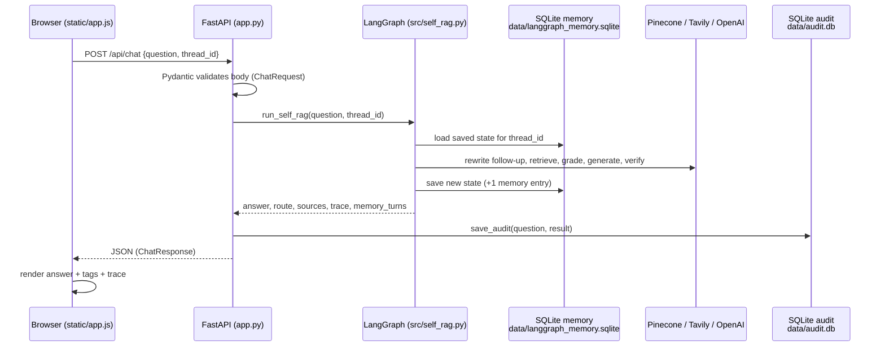
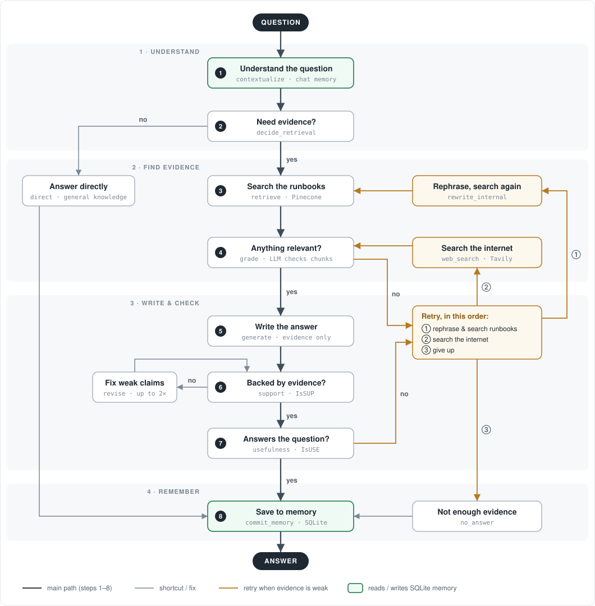

# Runbook Copilot

**A Self-RAG incident-response copilot for cloud operations.**

You describe a production problem ("checkout API returns 502 after deployment"). The copilot:

1. searches **your own runbooks** (stored in Pinecone) first,
2. checks whether what it found is actually relevant,
3. writes an answer **only from that evidence**,
4. double-checks the answer is supported (**IsSUP**) and useful (**IsUSE**),
5. falls back to **internet search** (Tavily) only when your runbooks can't answer,
6. **remembers the conversation** in SQLite, so follow-ups like *"what next?"* make sense.

The backend is **FastAPI**, the workflow is a **LangGraph** state machine, and memory is a **LangGraph SQLite checkpointer**. The README explains each of these in plain terms, pointing at the exact lines in this repo.

---

## Table of Contents

1. [What has been built (changelog)](#1-what-has-been-built-changelog)
2. [The big picture: what happens when you press Send](#2-the-big-picture-what-happens-when-you-press-send)
3. [Project structure](#3-project-structure)
4. [FastAPI, explained with this code](#4-fastapi-explained-with-this-code)
5. [SQLite memory, explained with this code](#5-sqlite-memory-explained-with-this-code)
6. [The Self-RAG workflow (LangGraph)](#6-the-self-rag-workflow-langgraph) · [The knowledge base](#6b-the-knowledge-base-documents)
7. [Run it locally](#7-run-it-locally)
8. [Run it with Docker](#8-run-it-with-docker)
9. [Deploy to an Oracle Cloud VM](#9-deploy-to-an-oracle-cloud-vm) · [Deploy to Render](#9b-deploy-to-render)
10. [Configuration reference](#10-configuration-reference)
11. [Troubleshooting](#11-troubleshooting)
12. [Moving to production](#12-moving-to-production)
13. [Security notes](#13-security-notes)
14. [License](#14-license)

---

## 1. What has been built (changelog)

| Area | What was done | Where |
|---|---|---|
| Knowledge base | Loader for PDF / TXT / MD / DOCX, chunking (800 chars, 160 overlap), OpenAI embeddings, upsert into Pinecone with **stable chunk IDs** (re-running doesn't create duplicates) | `src/ingestion.py`, `data_ingestion.py` |
| Single vector config | One module owns the embedding model, dimension, index and namespace; ingestion and retrieval both use it | `src/vectorstore.py` |
| Self-RAG workflow | 14-node LangGraph graph: contextualize → decide → retrieve → grade → rewrite → web search → generate → IsSUP → revise → IsUSE → commit memory | `src/self_rag.py` |
| Conversation memory | LangGraph `SqliteSaver` checkpointer keyed by `thread_id`; follow-up questions are rewritten using earlier turns | `src/self_rag.py`, `data/langgraph_memory.sqlite` |
| Audit log | Every Q&A stored in a plain SQLite table, readable via `GET /api/audits` | `src/db.py`, `data/audit.db` |
| API | FastAPI endpoints: UI, chat, upload, health, audits; Pydantic request/response validation | `app.py`, `src/models.py` |
| UI | Incident console with suggested prompts, evidence/source tags, workflow trace, runbook upload, "New Session" button | `templates/index.html`, `static/app.js`, `static/styles.css` |
| **Fix:** suggested prompts / Send dead after deployment | `crypto.randomUUID()` only exists on HTTPS or `localhost`. On a plain-HTTP server it threw an error on line 3 of `app.js`, so **no buttons were wired up**. It now falls back to `crypto.getRandomValues()`, which works everywhere | `static/app.js` → `newThreadId()` |
| **Fix:** ingestion edge cases | `ingest_file` returned from inside the loop, and returned `None` for an empty file (crashing uploads/bulk ingest). DOCX metadata stored the text `"<class 'pathlib.Path'>"` as the source instead of the file path | `src/ingestion.py` |
| **Fix:** chat request could hang for ~30 min | `ChatOpenAI` had no timeout, so one stalled OpenAI call blocked the request (seen during Docker testing). Now `LLM_TIMEOUT_SECONDS` (120 s) with 2 retries | `src/self_rag.py` → `_llm()` |
| **Knowledge base: 100 documents** | 97 new fictional documents for one consistent (made-up) company: 20 service runbooks, 20 infrastructure runbooks, 10 database/data runbooks, 15 SOPs, 15 postmortems, 6 alert playbooks, 4 observability guides, 7 architecture notes, 3 security/cost runbooks. 231 chunks in Pinecone. **No code changes** were needed | `documents/` |
| Port | `python app.py` now uses port **8000**, the same as `uvicorn` and Docker (was 8080) | `app.py` |
| Docker | `Dockerfile`, `.dockerignore`, `docker-compose.yml` with volumes so memory and uploads survive rebuilds, health check | repo root |
| Render | `render.yaml` Blueprint: Docker web service, health check, secrets entered in the dashboard; the Dockerfile honours Render's `PORT` | repo root |
| Config template | `.env.example` with every setting | repo root |
| Docs & comments | This README, plus beginner-oriented comments in `app.py`, `src/models.py`, `src/db.py`, `src/self_rag.py`, `src/config.py`, `static/app.js` | — |

---

## 2. The big picture: what happens when you press Send



In words:

1. **Browser.** `static/app.js` keeps a `thread_id` (like `incident-3f2a…`) in `localStorage` and sends it with every question.
2. **FastAPI.** `app.py` receives `POST /api/chat`, checks the JSON against `ChatRequest`, and calls `run_self_rag` on a background thread.
3. **LangGraph.** It loads the saved conversation for that `thread_id` from SQLite, runs the Self-RAG steps, then saves the updated conversation back.
4. **Audit.** `app.py` also writes the question and answer into `data/audit.db`.
5. **Browser.** It draws the answer, the route tag (Private Runbooks / Internet Search / …), the IsSUP/IsUSE tags, the sources and the trace.

---

## 3. Project structure

```text
runbook-copilot/
├── app.py                 # FastAPI app: all HTTP endpoints (UI, chat, upload, health, audits)
├── data_ingestion.py      # CLI: load everything in ./documents into Pinecone
├── src/
│   ├── config.py          # Settings read from environment variables / .env
│   ├── models.py          # Pydantic schemas = shape of API requests & responses
│   ├── db.py              # SQLite audit log (NOT the memory)
│   ├── ingestion.py       # Load → chunk → embed → upsert documents
│   ├── vectorstore.py     # Embeddings + Pinecone index + namespace (single source of truth)
│   └── self_rag.py        # LangGraph Self-RAG workflow + SQLite memory checkpointer
├── documents/             # 100 fictional runbooks, SOPs, postmortems, playbooks, architecture notes
├── templates/index.html   # The UI page
├── static/
│   ├── app.js             # UI logic: thread_id, send question, upload, render answers
│   └── styles.css
├── data/                  # (created at runtime, git-ignored) SQLite files
│   ├── langgraph_memory.sqlite   # conversation memory
│   └── audit.db                  # Q&A audit log
├── uploads/               # (runtime, git-ignored) runbooks uploaded from the UI
├── Dockerfile             # How to build the container image
├── docker-compose.yml     # How to run it (ports, .env, volumes, restart policy)
├── render.yaml            # Render Blueprint (one-click deploy on Render)
├── .dockerignore          # Files kept out of the image (.env, data/, .git …)
├── .env.example           # Template for your .env
├── requirements.txt
└── template.py            # One-off script that scaffolded the folders/files
```

---

## 4. FastAPI, explained with this code

### 4.1 What FastAPI and uvicorn are

- **FastAPI** is a Python library for building web APIs. You write normal Python functions, and FastAPI turns them into URLs the browser can call.
- **uvicorn** is the web server that actually listens on a port and hands requests to FastAPI.

```bash
uvicorn app:app --reload
#        │   │     └─ restart automatically when you edit code (dev only)
#        │   └─ the variable named `app` …
#        └─ … inside the file app.py
```

### 4.2 The `app` object

```python
# app.py
app = FastAPI(title="Runbook Copilot — …", version="2.0.0", …)
```

Everything hangs off this object. The title and version show up on the auto-generated docs page.

### 4.3 Routes: one decorated function = one URL

```python
@app.get("/api/health")          # HTTP method + path
def health():                    # a normal function
    return {"status": "ok", …}   # a dict → FastAPI sends it as JSON
```

All routes in this project:

| Method & path | Function in `app.py` | What it does |
|---|---|---|
| `GET /` | `home` | Returns the HTML page (`templates/index.html`) |
| `GET /static/...` | (mounted) | Serves `app.js`, `styles.css` |
| `GET /api/health` | `health` | `{"status": "ok"}`, used by Docker's health check |
| `POST /api/chat` | `chat` | Runs Self-RAG for a question and returns the answer |
| `POST /api/upload` | `upload` | Adds a runbook file to the Pinecone knowledge base |
| `GET /api/audits?limit=20` | `audits` | Latest rows from the SQLite audit log |

### 4.4 Request validation with Pydantic (`src/models.py`)

```python
class ChatRequest(BaseModel):
    question: str = Field(..., min_length=2, max_length=2000)   # ... = required
    thread_id: str = Field(..., min_length=3, max_length=120)

@app.post("/api/chat", response_model=ChatResponse)
async def chat(payload: ChatRequest):    # ← this type hint does the magic
    ...
```

Because `payload` is typed as `ChatRequest`, FastAPI:

1. reads the JSON body,
2. checks that `question` and `thread_id` exist, are strings and have valid lengths,
3. **automatically rejects bad requests with HTTP 422**, so your function never runs on bad data,
4. gives you a typed object (`payload.question`, `payload.thread_id`).

`response_model=ChatResponse` does the same in the other direction. It checks what you return and turns it into JSON with exactly those fields. `static/app.js` relies on these fields (`answer`, `route`, `sources`, `trace`, `memory_turns`, …).

### 4.5 `async` + `run_in_threadpool`: keeping the server responsive

```python
async def chat(payload: ChatRequest):
    result = await run_in_threadpool(run_self_rag, payload.question.strip(), payload.thread_id.strip())
```

`run_self_rag` makes many slow, blocking LLM calls (5–30 s). If it ran directly inside an `async` function, the whole server would freeze until it finished, and nobody else could even load the page. `run_in_threadpool` runs it on a separate worker thread, and `await` waits for the result without blocking the server.

> Rule of thumb: in an `async def` endpoint, wrap slow non-async work in `run_in_threadpool`.

### 4.6 Errors: `HTTPException`

```python
except Exception as e:
    raise HTTPException(status_code=500, detail=str(e))
```

FastAPI turns this into a response with status 500 and body `{"detail": "…"}`. The UI shows it as **"Request failed: …"**. Upload uses `status_code=400` for unsupported file types.

### 4.7 File uploads: `UploadFile`

```python
@app.post("/api/upload", response_model=UploadResponse)
async def upload(file: UploadFile = File(...)):
```

`File(...)` tells FastAPI to expect a **multipart form** with a field called `file`. That is what the browser's `FormData` sends (see `static/app.js`). This needs the `python-multipart` package, which is in `requirements.txt`. The code keeps only the bare file name (`Path(file.filename).name`), so a name like `../../etc/passwd` can't write outside `uploads/`.

### 4.8 Serving the UI

```python
app.mount("/static", StaticFiles(directory="static"), name="static")   # /static/app.js → static/app.js
templates = Jinja2Templates(directory="templates")                     # renders templates/index.html
```

### 4.9 Startup hook

```python
@app.on_event("startup")
def startup():
    init_db()      # create the audit table if it doesn't exist
```

### 4.10 Try the API without the UI

Start the app and open **http://127.0.0.1:8000/docs**. FastAPI generates an interactive page from your code where you can call every endpoint. You can also use the command line:

```bash
curl http://127.0.0.1:8000/api/health

curl -X POST http://127.0.0.1:8000/api/chat \
  -H "Content-Type: application/json" \
  -d '{"question": "Checkout API returns 502 after deployment. What first?", "thread_id": "incident-demo-1"}'

# follow-up in the SAME thread → uses memory
curl -X POST http://127.0.0.1:8000/api/chat \
  -H "Content-Type: application/json" \
  -d '{"question": "And if that does not fix it?", "thread_id": "incident-demo-1"}'

curl -F "file=@documents/checkout-api-runbook.md" http://127.0.0.1:8000/api/upload
curl "http://127.0.0.1:8000/api/audits?limit=5"
```

---

## 5. SQLite memory, explained with this code

### 5.1 Two SQLite files with two different jobs

| File | Job | Who writes it | Code |
|---|---|---|---|
| `data/langgraph_memory.sqlite` | **Conversation memory**: lets follow-ups use earlier turns | LangGraph, automatically | `build_graph()` in `src/self_rag.py` |
| `data/audit.db` | **Audit log**: permanent record of every Q&A, for review | Our own SQL | `src/db.py` |

SQLite is a full SQL database stored in **one file**. There is no server to install, and Python ships with it (`import sqlite3`).

### 5.2 Four ideas you need

1. **State.** A Python dict (`RAGState`) that travels through the graph: question, retrieved docs, answer, and so on. Each node returns only the keys it changes.
2. **`thread_id`.** The name of a conversation. The browser creates it and sends it with every question.
3. **Checkpointer.** A LangGraph plug-in that **saves the state after a run and loads it before the next run** with the same `thread_id`. Here it's `SqliteSaver`, which stores those snapshots in the SQLite file.
4. **Reducer.** A rule for merging a new value into a saved value. Most keys are simply **replaced**. `memory` uses `operator.add`, so new entries are **appended**.

### 5.3 The code, piece by piece

**① The browser creates and remembers a `thread_id`.** (`static/app.js`)

```js
let threadId = localStorage.getItem(THREAD_KEY) || newThreadId();   // reuse, or make a new one
localStorage.setItem(THREAD_KEY, threadId);
// ... every request:
body: JSON.stringify({ question, thread_id: threadId })
```

`localStorage` survives page refreshes, so a refresh continues the same incident. **New Session** generates a new id, which means empty memory.

**② The memory field appends instead of overwriting.** (`src/self_rag.py`)

```python
class RAGState(TypedDict, total=False):
    memory: Annotated[List[str], operator.add]   # saved + new
```

**③ The graph is compiled with a SQLite checkpointer.** (`build_graph()`)

```python
conn = sqlite3.connect("data/langgraph_memory.sqlite", check_same_thread=False)
checkpointer = SqliteSaver(conn)
return g.compile(checkpointer=checkpointer)
```

`check_same_thread=False` is needed because FastAPI handles requests on different threads that share this one connection.

**④ Every run is tied to a thread.** (`run_self_rag()`)

```python
result = _graph.invoke(initial, config={"configurable": {"thread_id": thread_id}})
```

`"memory": []` in `initial` does **not** wipe the history. The reducer computes `saved_memory + [] = saved_memory`. The other keys in `initial` (answer, docs, counters…) *are* reset, because they don't have a reducer.

**⑤ The first node reads memory and rewrites the question.** (`contextualize_question()`)

```python
if not state.get("memory"):            # brand-new thread → nothing to do
    return {"question": user_question, ...}
# otherwise ask the LLM: "rewrite this follow-up as a standalone question using the history"
```

Only the **last 4 turns** are sent (`_memory_text(limit=4)`), so prompts stay small however long the session gets.

**⑥ The last node writes one new memory entry.** (`commit_memory()`)

```python
entry = f"User: {user_question}\nAssistant ({route}): {answer}"
return {"memory": [entry]}             # appended thanks to operator.add, then saved to SQLite
```

### 5.4 Walk-through: two messages in one session

| | Message 1 | Message 2 |
|---|---|---|
| User types | "Our checkout API is returning 502 errors after deployment. What should I check first?" | "What should I check next if that doesn't work?" |
| Loaded from SQLite | nothing (new `thread_id`) | `memory = [turn 1]` |
| `contextualize` | keeps the question as-is | rewrites it → *"What should I check next for checkout API 502 errors after a deployment if the first checks don't help?"* |
| Retrieval uses | the original question | the **rewritten** question, so Pinecone finds the checkout runbook again |
| `commit_memory` | `memory = [turn 1]` | `memory = [turn 1, turn 2]` |
| UI tag | `SQLITE MEMORY · 1 TURN` | `SQLITE MEMORY · 2 TURNS` |

Without memory, message 2 would search Pinecone for "what should I check next", which matches nothing useful.

### 5.5 Look inside the database yourself

```bash
sqlite3 data/langgraph_memory.sqlite ".tables"
# checkpoints  writes        ← tables LangGraph created for you

sqlite3 data/langgraph_memory.sqlite \
  "SELECT thread_id, COUNT(*) AS snapshots FROM checkpoints GROUP BY thread_id;"

sqlite3 -header -column data/audit.db \
  "SELECT id, created_at, route, substr(question,1,60) AS question FROM rag_audit ORDER BY id DESC LIMIT 5;"
```

The checkpoint data itself is stored as serialized blobs (LangGraph's format), so read memory through the app rather than by hand. The audit table is plain columns and easy to query.

### 5.6 Reset memory

- **One conversation:** click **New Session** in the UI.
- **Everything (local):** stop the app, then `rm data/langgraph_memory.sqlite*`.
- **Everything (Docker):** `docker compose down -v` (also deletes uploads and the audit log).

### 5.7 Limitations

- SQLite suits a single server. Several servers would each have their own memory file, so use Postgres for that (see [Moving to production](#12-moving-to-production)).
- Memory grows forever per thread (only the last 4 turns are *used*). Old threads can be deleted safely.
- Anyone who knows a `thread_id` can continue that conversation. There is no login yet.

---

## 6. The Self-RAG workflow (LangGraph)

The graph built in `build_graph()` (`src/self_rag.py`). Each box shows what the step does in plain English, with its node name in the code underneath.

<p align="center"></p>

How to read it:

- **Follow the numbers 1 → 8 down the middle.** That's the normal path for a question the runbooks can answer.
- **Questions in boxes are decisions.** "yes" continues down the main path, and "no" branches off.
- **Grey side paths.** General questions skip the search (*Answer directly*). An answer with unsupported claims gets fixed (*Fix weak claims*, up to 2 times), then is checked again.
- **Amber retry paths.** When nothing relevant is found (step 4), or the answer doesn't address the question (step 7), the assistant retries in order:
  1. rephrase the query and search the runbooks again (up to `MAX_RETRIEVAL_REWRITES`)
  2. search the internet with Tavily (up to `MAX_WEB_REWRITES`)
  3. give up and reply "not enough evidence"

  This rule lives in `route_after_relevance` and `route_after_usefulness`. *Search the internet* covers two nodes, `rewrite_web` followed by `web_search`.
- **Green steps use the SQLite memory.** Step 1 reads earlier turns, and step 8 saves this turn.

### How this differs from a basic Self-RAG graph

A textbook Self-RAG graph is: `decide_retrieval → (generate_direct | retrieve) → is_relevant → generate_from_context → IsSUP ⇄ revise_answer → IsUSE → (END | rewrite_question → retrieve | no_answer_found)`. This project keeps that whole loop and adds two things around it:

| Added | Nodes | Why |
|---|---|---|
| **Conversation memory** | `contextualize` (start), `commit_memory` (end), SQLite checkpointer | Follow-ups like "what next?" become full questions, and every turn is saved per `thread_id` |
| **Web fallback** | `rewrite_web`, `web_search` | When the runbooks have nothing relevant after `MAX_RETRIEVAL_REWRITES` tries, search the internet instead of giving up straight away |

**Tavily does not replace the LLM for generation.** OpenAI still writes every answer (`generate`, `direct`, `revise`) and does every check (`grade`, `support`, `usefulness`). Tavily is a second **retrieval source**. It only fetches web pages, which then go through the same `grade → generate → support → usefulness` steps as runbook chunks. Adding a web search when local retrieval fails is an idea borrowed from Corrective RAG (CRAG).

| Node | Purpose |
|---|---|
| `contextualize` | Uses saved memory to turn a follow-up into a standalone question |
| `decide_retrieval` | Decides whether evidence is needed (almost always yes for ops questions) |
| `direct` | Answers generic questions from general knowledge, never inventing org-specific details |
| `retrieve` | Similarity search in Pinecone (`TOP_K` chunks) |
| `grade` | LLM keeps only the chunks that are relevant |
| `rewrite_internal` | Rewrites the query for another Pinecone attempt (max `MAX_RETRIEVAL_REWRITES`) |
| `rewrite_web` + `web_search` | Internet fallback via Tavily (max `MAX_WEB_REWRITES`) |
| `generate` | Writes the answer **only** from the graded evidence |
| `support` (IsSUP) | Is every claim backed by the evidence? |
| `revise` | Rewrites unsupported parts (max `MAX_SUPPORT_RETRIES`) |
| `usefulness` (IsUSE) | Does the answer actually address the question? |
| `no_answer` | Safe "not enough evidence" reply instead of guessing |
| `commit_memory` | Appends the turn to memory, which the checkpointer saves to SQLite |

Each LLM step uses `OPENAI_MODEL` (default `gpt-5-mini`). Decision steps use `with_structured_output(...)`, so the model must answer with JSON matching a Pydantic class (e.g. `RelevanceDecision(is_relevant: bool)`) instead of free text.

---

## 6b. The knowledge base (`documents/`)

All 100 documents describe one **fictional** e-commerce company, so services, teams and tools are consistent across documents (checkout-api, payments-service, PgBouncer, Argo CD, PagerDuty, and so on). Nothing in them is real company data.

| Type | Count | File name pattern | Examples |
|---|---|---|---|
| Service runbooks | 20 | `<service>-runbook.md` | checkout-api, cart, inventory, payment gateway, Redis, search, auth, Kafka |
| Infrastructure runbooks | 20 | `kubernetes-*`, `rds-*`, `tls-*` … | CrashLoopBackOff, OOMKilled, node NotReady, TLS expiry, Argo CD sync failure |
| Database & data runbooks | 10 | `postgres-*`, `redis-*`, `kafka-*` | connection pool exhaustion, replication lag, deadlocks, consumer lag |
| SOPs | 15 | `*-sop.md` | severity levels, incident commander, canary deploys, kill switches, break-glass |
| Postmortems | 15 | `postmortem-YYYY-MM-*.md` | expired certificate, retry-storm double charges, Black Friday Redis evictions |
| Alert playbooks & guides | 10 | `alert-*-playbook.md`, `*-guide.md` | 5xx rate, SLO burn rate, dashboards, log search, tracing |
| Architecture & security | 10 | `*-architecture.md`, `*-overview.md`, … | system overview, checkout flow, DR strategy, leaked credentials, DDoS |

**Deliberate gaps** (so the web fallback can be demonstrated): Istio / service mesh, gRPC, GraphQL, MongoDB, GCP / Azure, JVM tuning.

**Adding or changing documents:** edit files in `documents/` and run `python data_ingestion.py`. Unchanged chunks keep the same ID, so re-running only adds or updates what changed. Don't put a `README.md` inside `documents/`, because it would be ingested as a runbook. To delete a document from the index, remove its vectors in Pinecone too; deleting the file alone doesn't remove them.

---

## 7. Run it locally

**Prerequisites:** Python 3.11 (conda or venv), plus OpenAI, Pinecone and Tavily API keys.

```bash
git clone https://github.com/kaushik183/runbook-copilot.git
cd runbook-copilot

conda create -n env_runbook_project python=3.11 -y
conda activate env_runbook_project
pip install -r requirements.txt

cp .env.example .env          # then put your keys in .env

python data_ingestion.py      # one-time: load ./documents into Pinecone (safe to re-run)

uvicorn app:app --reload      # or: python app.py
```

Open **http://127.0.0.1:8000**. The API docs are at **http://127.0.0.1:8000/docs**.

**Demo script**

1. Click **502 after deployment**. Expect the route **Private Runbooks** and sources from `checkout-api-runbook.md`.
2. Ask *"What should I check next if that doesn't work?"* The memory tag goes to 2 turns, and the answer continues the same incident.
3. Upload a new runbook in **Runbook Vault**, then ask about something only it contains.
4. Ask something no runbook covers, for example *"How do I debug Istio sidecar injection failures?"* The route becomes **Internet Search**. This path takes a few minutes, because the app first retries the runbooks before going to the web.
5. Click **New Session**. Memory starts empty again.

---

## 8. Run it with Docker

```bash
cp .env.example .env            # fill in keys (skip if you already have .env)
docker compose up -d --build    # build the image and start in the background
docker compose logs -f          # watch logs (Ctrl+C to stop watching)
```

Open **http://127.0.0.1:8000**.

What the files do:

- **`Dockerfile`**: starts from `python:3.11-slim`, installs `requirements.txt`, copies the code and runs `uvicorn app:app --host 0.0.0.0 --port 8000`. `0.0.0.0` means "accept connections from outside the container". It also has a health check against `/api/health`.
- **`.dockerignore`**: keeps `.env`, `.git`, `data/` and `uploads/` **out of the image**, so secrets never get baked in.
- **`docker-compose.yml`**: passes `.env` at runtime, maps port 8000, and mounts **named volumes** on `/app/data` and `/app/uploads`. Your SQLite memory, audit log and uploads survive `docker compose up --build` and restarts. `restart: unless-stopped` brings the app back after a crash or reboot.

Useful commands:

```bash
docker compose ps               # status (shows "healthy" once /api/health answers)
docker compose restart          # restart the app
docker compose down             # stop (data volumes are kept)
docker compose down -v          # stop AND delete memory/audit/uploads volumes
```

Without Compose:

```bash
docker build -t runbook-copilot .
docker run -d --name runbook-copilot --env-file .env -p 8000:8000 \
  -v runbook_data:/app/data -v runbook_uploads:/app/uploads runbook-copilot
```

> ⚠️ `docker run --env-file` does **not** strip quotes. `KEY="value"` becomes the literal value `"value"`, quotes included. Write `KEY=value` without quotes, or use `docker compose`, which handles quotes.

> Pinecone is a cloud service, so run `python data_ingestion.py` once from any machine with the same `.env`. The container reads the same index.

---

## 9. Deploy to an Oracle Cloud VM

These steps work on an Oracle Cloud free-tier VM, on either Ubuntu or Oracle Linux, on Ampere (ARM) or x86.

### 9.1 Open port 8000

1. **Oracle Console** → *Networking → Virtual Cloud Networks → your VCN → Security Lists → Default* → **Add Ingress Rule**: source `0.0.0.0/0`, protocol TCP, destination port `8000`.
2. **On the VM**, open the OS firewall too:

   ```bash
   # Ubuntu images (iptables)
   sudo iptables -I INPUT 6 -m state --state NEW -p tcp --dport 8000 -j ACCEPT
   sudo netfilter-persistent save

   # Oracle Linux images (firewalld)
   sudo firewall-cmd --permanent --add-port=8000/tcp && sudo firewall-cmd --reload
   ```

### 9.2 Install Docker and git on the VM

```bash
ssh -i ~/.ssh/oracle_freetier.key ubuntu@<VM_PUBLIC_IP>     # user is "opc" on Oracle Linux

curl -fsSL https://get.docker.com | sudo sh                   # Docker + compose plugin
sudo usermod -aG docker $USER && newgrp docker                # run docker without sudo
sudo apt-get install -y git || sudo dnf install -y git
```

### 9.3 Get the code and secrets onto the VM

```bash
git clone https://github.com/kaushik183/runbook-copilot.git
cd runbook-copilot
```

Copy your `.env` from your laptop. It's git-ignored, so `git clone` won't bring it:

```bash
# run this on your laptop
scp -i ~/.ssh/oracle_freetier.key .env ubuntu@<VM_PUBLIC_IP>:~/runbook-copilot/.env
```

### 9.4 Start it

```bash
docker compose up -d --build
docker compose ps                     # wait for "healthy"
curl http://127.0.0.1:8000/api/health
```

Open **http://<VM_PUBLIC_IP>:8000** in your browser.

### 9.5 Ship an update later

```bash
cd ~/runbook-copilot
git pull
docker compose up -d --build          # rebuilds; memory/uploads volumes are kept
```

After an update, hard-refresh the browser (Cmd/Ctrl + Shift + R) so it doesn't keep an old `app.js`.

### 9.6 (Recommended) HTTPS

Plain `http://IP:8000` works, and the suggested-prompt fix means the UI no longer needs HTTPS. For anything beyond a demo, put HTTPS in front so traffic and the knowledge base aren't exposed. The simplest option is [Caddy](https://caddyserver.com/docs/quick-starts/reverse-proxy) with a domain name: `caddy reverse-proxy --from your.domain --to localhost:8000` gets and renews a certificate automatically.

---

## 9b. Deploy to Render

Render builds the same `Dockerfile` straight from GitHub, serves it over **HTTPS** at `https://<name>.onrender.com`, and redeploys on every push to `main`. `render.yaml` (a Render "Blueprint") already describes the service.

### Steps

1. Make sure Pinecone already has your runbooks. Run `python data_ingestion.py` once locally; Render reads the same index.
2. Open **https://render.com/deploy?repo=https://github.com/kaushik183/runbook-copilot**, or go to *Render Dashboard → New → Blueprint* and pick this repo.
3. Render reads `render.yaml` and asks for the three secrets marked `sync: false`: `OPENAI_API_KEY`, `PINECONE_API_KEY`, `TAVILY_API_KEY`. Paste them, then click **Apply**.
4. Wait for the first build (~5 min). Render checks `/api/health` before sending traffic.
5. Open the URL shown in the dashboard.

Optional LangSmith tracing: add `LANGSMITH_TRACING`, `LANGSMITH_API_KEY` and `LANGSMITH_PROJECT` under *Environment* in the dashboard.

### What Render handles for you vs. what to know

| | Render free plan |
|---|---|
| Dockerfile build, HTTPS certificate, auto-deploy on push | ✅ handled |
| `PORT` | Render injects it; the Dockerfile's `--port ${PORT}` picks it up |
| RAM (512 MB) | ✅ enough. The container uses ~160 MB after answering a chat |
| **Sleeps after ~15 min idle** | The first request after a nap takes ~1 min while it wakes up |
| **No persistent disk** | `data/` (SQLite memory and audit log) and `uploads/` are **wiped on every deploy, restart or sleep**. Runbooks uploaded through the UI stay searchable, because their vectors live in Pinecone, but conversation memory is lost when the instance restarts |

To keep memory on Render, use a paid instance and uncomment the `disk:` block in `render.yaml`. It mounts a persistent disk at `/app/data`. Otherwise, for permanent memory on a free host, use the Oracle VM setup in section 9, where Docker volumes keep data across restarts.

---

## 10. Configuration reference

All settings come from `.env` (see `.env.example`) and are read in `src/config.py`.

| Variable | Required | Default | Meaning |
|---|---|---|---|
| `OPENAI_API_KEY` | yes | | OpenAI key (LLM + embeddings) |
| `PINECONE_API_KEY` | yes | | Pinecone key |
| `TAVILY_API_KEY` | for web fallback | | Tavily key; without it the web step returns no results |
| `OPENAI_MODEL` | no | `gpt-5-mini` | Chat model for every LLM step |
| `LLM_TIMEOUT_SECONDS` | no | `120` | Max wait for one LLM call before it's retried (max 2 retries) |
| `EMBEDDING_MODEL` | no | `text-embedding-3-large` | Embedding model (ingestion **and** retrieval) |
| `EMBEDDING_DIMENSION` | no | `3072` | Must match the model **and** the Pinecone index |
| `PINECONE_INDEX_NAME` | no | `runbook-copilot` | Index name (created automatically if missing) |
| `PINECONE_NAMESPACE` | no | `incident-runbooks` | Namespace inside the index |
| `PINECONE_CLOUD` / `PINECONE_REGION` | no | `aws` / `us-east-1` | Where a new serverless index is created |
| `TOP_K` | no | `5` | Chunks retrieved per search |
| `MAX_RETRIEVAL_REWRITES` | no | `2` | Extra Pinecone attempts before going to the web |
| `MAX_WEB_REWRITES` | no | `2` | Web search attempts before giving up |
| `MAX_SUPPORT_RETRIES` | no | `2` | Times an unsupported answer is revised |
| `DATABASE_PATH` | no | `data/audit.db` | Audit log location (memory is always `data/langgraph_memory.sqlite`) |
| `LANGSMITH_*` | no | | Optional LangSmith tracing |

> **Consistency rule:** ingestion and retrieval both go through `src/vectorstore.py`, so they always use the same model, dimension, index and namespace. If you change `EMBEDDING_MODEL` or `EMBEDDING_DIMENSION`, use a **new** `PINECONE_INDEX_NAME` and re-run `python data_ingestion.py`.

---

## 11. Troubleshooting

| Symptom | Likely cause | Fix |
|---|---|---|
| Suggested prompts / Send do nothing on the deployed site | Old `app.js` cached in the browser (from before the `crypto.randomUUID` fix) | Hard-refresh (Cmd/Ctrl + Shift + R); check the browser console for errors |
| Can't open `http://<VM_IP>:8000` | Port blocked | Add the Security List ingress rule **and** the OS firewall rule (section 9.1) |
| `Request failed: OPENAI_API_KEY is not configured` | `.env` missing in the container | Make sure `.env` is next to `docker-compose.yml`, then `docker compose up -d` |
| Pinecone dimension mismatch | Index created with a different dimension | Use a new `PINECONE_INDEX_NAME` or delete the old index |
| Every answer routes to Internet Search | Namespace empty, or different from the one used at ingestion | Run `python data_ingestion.py`; check `PINECONE_NAMESPACE` |
| Follow-ups lose context | New browser/session (new `thread_id`), or memory file deleted | Stay in the same session; in Docker keep the `runbook_data` volume |
| Upload says `Supported: PDF, TXT, MD, DOCX` | Wrong file type | Convert the file |
| Port 8000 already in use | Something else is listening | `uvicorn app:app --port 8001` (or change `ports:` in compose to `"8001:8000"`) |
| `conda activate` not recognized | Shell not initialised for conda | `conda init`, then restart the terminal |

---

## 12. Moving to production

- **Memory:** replace `SqliteSaver` with LangGraph's Postgres checkpointer so several app instances can share memory.
- **Audit log:** move `rag_audit` to a managed database.
- **Auth:** add login to the UI and **especially** to `/api/upload`, because anyone who can upload can change what the copilot treats as trusted knowledge.
- **HTTPS:** terminate TLS with Caddy or nginx, or use a load balancer.
- **Secrets:** use a secret manager instead of a `.env` file.
- **Container:** run as a non-root user, and pin dependency versions in `requirements.txt`.
- **Observability:** enable LangSmith tracing to inspect routing and grading decisions.

---

## 13. Security notes

- Never commit `.env`. It's git-ignored and excluded from the Docker image by `.dockerignore`.
- `data/` (conversation memory, audit log) and `uploads/` are git-ignored too.
- Uploads go straight into the shared Pinecone namespace. Treat upload access as write access to the knowledge base.
- Web search results are untrusted external content. They're graded for relevance but should still be verified before you act on them during a live incident.
- The app has no authentication yet, so don't expose it publicly with sensitive runbooks.

---

## 14. License

MIT. See [LICENSE](LICENSE).
